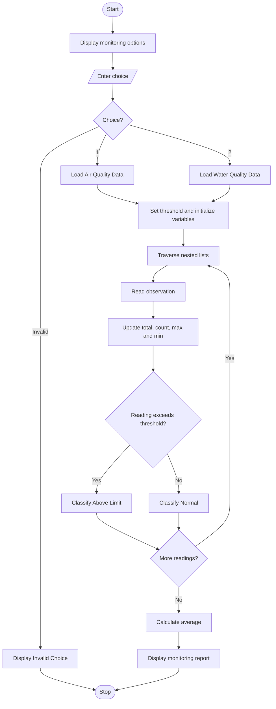

# Environmental-Monitoring-Data-Analyzer
# Case Study: Environmental Monitoring Data Analyzer

## Problem Statement
Develop a Python program to analyze environmental monitoring data such as air-quality or water-quality readings stored in nested lists. The program calculates the average, maximum, and minimum values, and classifies each observation based on a given threshold.

## Objectives
- Store environmental readings using nested lists.
- Calculate total number of readings and average value.
- Identify maximum and minimum observations.
- Classify readings as Normal or Above Limit.
- Generate a simple environmental monitoring report.

## Assumptions
- Readings are stored in nested lists.
- Each nested list represents a day's observations.
- The threshold value is predefined.
- Readings greater than the threshold are classified as Above Limit.
- Readings equal to or below the threshold are classified as Normal.
- The sample readings are used for demonstration.

## Algorithm
1. Start the program.
2. Display the monitoring type options.
3. Select Air Quality or Water Quality.
4. Initialize the corresponding nested list and threshold.
5. Set total, count, maximum, and minimum values.
6. Traverse every reading using nested loops.
7. Calculate the total and count.
8. Update maximum and minimum readings.
9. Compare each reading with the threshold.
10. Display its classification.
11. Calculate the average reading.
12. Display the summary report.
13. Stop.

## Pseudocode

```text
START

DISPLAY "1. Air Quality"
DISPLAY "2. Water Quality"
INPUT choice

IF choice = 1
    SET air quality readings
    SET threshold = 100
ELSE IF choice = 2
    SET water quality readings
    SET threshold = 8.0
ELSE
    DISPLAY "Invalid choice"
    STOP
END IF

SET total = 0
SET count = 0
SET maximum = first reading
SET minimum = first reading

FOR each day in data
    FOR each reading in day
        ADD reading to total
        INCREMENT count

        IF reading > maximum
            UPDATE maximum
        END IF

        IF reading < minimum
            UPDATE minimum
        END IF

        IF reading <= threshold
            DISPLAY "Normal"
        ELSE
            DISPLAY "Above Limit"
        END IF
    END FOR
END FOR

CALCULATE average = total / count

DISPLAY total readings
DISPLAY average
DISPLAY maximum
DISPLAY minimum

STOP
```

## Flowchart



## Python Concepts Used
- Variables
- Lists and nested lists
- Functions
- `for` loops
- Nested loops
- `if-else` conditions
- Arithmetic operations
- User input
- `round()` function

## Test Cases

| Test Case | Input | Expected Result |
|---|---|---|
| TC01 | Choice 1 | Air quality report displayed |
| TC02 | Choice 2 | Water quality report displayed |
| TC03 | Choice 3 | Invalid choice message |
| TC04 | Air reading 45 | Normal |
| TC05 | Air reading 110 | Above Limit |
| TC06 | Air quality data | Average = 69.11 |
| TC07 | Air quality data | Maximum = 110 |
| TC08 | Air quality data | Minimum = 40 |

## Sample Output

### Air Quality

```text
Environmental Monitoring Data Analyzer
1. Air Quality
2. Water Quality
Select monitoring type: 1

Air Quality Selected

Environmental Monitoring Report
----------------------------------------
Day 1 Reading 1 : 45 - Normal
Day 1 Reading 2 : 60 - Normal
Day 1 Reading 3 : 72 - Normal
Day 2 Reading 1 : 55 - Normal
Day 2 Reading 2 : 80 - Normal
Day 2 Reading 3 : 95 - Normal
Day 3 Reading 1 : 40 - Normal
Day 3 Reading 2 : 65 - Normal
Day 3 Reading 3 : 110 - Above Limit

Summary
----------------------------------------
Total Readings : 9
Average Value  : 69.11
Maximum Value  : 110
Minimum Value  : 40
Threshold      : 100
```

## Conclusion

The Environmental Monitoring Data Analyzer successfully processes nested environmental readings, calculates statistical values, and classifies observations according to the specified threshold. This program demonstrates the use of basic Python programming concepts for environmental data analysis.
